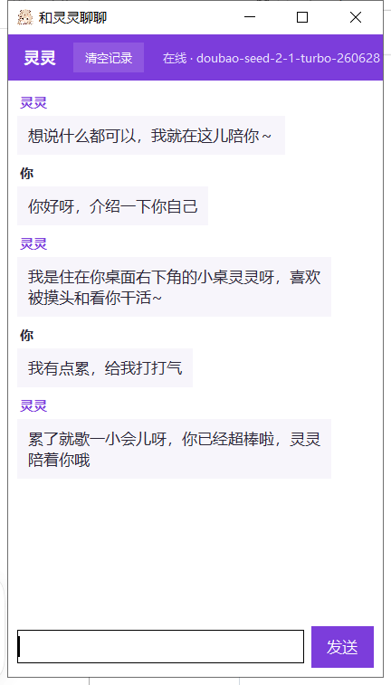
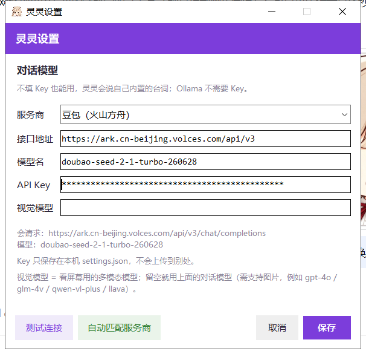

# 灵灵 · 桌面 AI 助理桌宠

> 一只住在桌面角落的小宠物，也是一个能帮你干活的助理。
> **把文件拖到她身上，回一个数字，就帮你转好格式。**

<p align="center">
  
</p>

<p align="center">
  
  
  
  <a href="https://github.com/linggan121/lingling-desktop-pet/releases/latest"></a>
</p>

<p align="center">
  
  
</p>

---

## 现在能做什么

- **文件助理（核心）**
  把文件（或文件夹）拖到灵灵身上，她会列出来并给编号选项：

  ```
  收到 2个文件，你要哪样？
  1. 转成 webp
  2. 用 to-pdf 预设
  3. 转成 jpg（质量 80）
  回数字就行，也可以直接说别的。
  ```

  - 回 **数字** → 直接执行
  - 直接说 **「转成 heic」「用 to-pdf 预设」「质量 60」「盯着这个文件夹」** → 复述确认后执行
  - 背后接 [Filee](https://github.com/KnifeLemon/Filee)（MIT，离线）：**270 种格式、预设、质量、批量**
  - **盯着文件夹**：后台监听，新文件自动转（说「停止监听」就停）
  - 不会的事直接说不会，不瞎答应
- **文件位置可点**：聊天里出现的文件都是青绿色小胶囊，点一下在资源管理器里打开并选中
- **记得聊天**：对话、拖进来的文件、转好的文件都存在本地，关掉窗口再打开还在，编号也还能接着回
- **桌面住客**：无边框、不占任务栏、置顶、可拖动、位置记忆、贴边吸附、托盘、单实例
- **会聊天**：接任意 OpenAI 兼容服务（DeepSeek / 豆包 / 硅基流动 / Kimi / 智谱 / 通义 / OpenRouter / 本地 Ollama），流式逐字回复；没配 Key 时只说自己内置的台词
- **记得你**：每聊 8 轮提炼一次「关于你的事」，存成本地事实卡
- **看屏幕**：右键「看看我在干什么」，截图让视觉模型点评；窗口标题命中密码 / 银行 / 支付等词时连截图都不截
- **有脾气**：回复里带 `<mood:开心>` 这类情绪标记会自动切动作，标记本身不显示

<p align="center">
  
</p>

---

## 快速开始

### 方式一：直接用 exe

到 **[Releases](https://github.com/linggan121/lingling-desktop-pet/releases/latest)** 下载 `lingling-v2.1.4-win64.exe`，双击即可。首次启动约 3–5 秒。

运行数据在：

```
%LOCALAPPDATA%\灵灵\
├── settings.json   位置、模型配置
├── chat_log.json   聊天记录（含文件链接）
├── history.json    给模型看的对话历史
├── memory.json     关于你的事实卡
├── lines.json      台词库（可改）
├── persona.json    人设（可改）
└── _frames.pkl     切帧缓存（可删）
```

想变成绿色便携版：在 exe 同目录建一个 `data` 文件夹，程序会优先用它。

### 方式二：源码运行

```bash
pip install -r requirements.txt
pythonw 灵灵.pyw              # 启动
python  灵灵.pyw --selftest   # 自检
python  灵灵.pyw --settings   # 启动并打开设置
```

需要 Python 3.9+（tkinter 是标准库自带的）。

### 想用文件转换？先装 Filee

文件转换交给 [Filee](https://github.com/KnifeLemon/Filee)（MIT、离线、270 种格式）。
装好后灵灵会自动找到它的命令行（PATH 里的 `filee`，或 `D:\Filee`、`%LOCALAPPDATA%\Programs\Filee`）。
没装也能正常用桌宠，只是拖文件时她会说暂时只能陪你聊天。

---

## 文件技能怎么用

**拖**：把文件或文件夹拖到她身上 → 聊天窗自动打开 → 回数字或直接下指令。

**不想拖**：右键 →「技能 → 选文件转换…」。

支持的说法：

| 你说 | 她做 |
|---|---|
| `1` / `2` / `3` | 执行对应编号选项 |
| `转成 webp`、`换成 png`、`导出 pdf` | 转换格式 |
| `转成 jpg，质量 80` | 带质量参数 |
| `用 to-pdf 预设`、`用 Half size` | 用 Filee 的预设 |
| `你支持哪些格式` | 列出 270 种格式 |
| `盯着这个文件夹，转成 jpg` | 后台监听，新文件自动转 |
| `停止监听` | 结束监听 |

做不到的（合并、拆分、重命名、整理、OCR、翻译…）她会直接说明，不会假装能做。

---

## 接大模型

右键灵灵 →「设置…」，选服务商 → 填 Key →「测试连接」→ 成功会自动保存。

| 服务商 | 接口地址 | 备注 |
|---|---|---|
| DeepSeek | `https://api.deepseek.com` | Key 是 `sk-` 开头 |
| 豆包（火山方舟） | `https://ark.cn-beijing.volces.com/api/v3` | 模型填 **Model ID**（如 `doubao-seed-2-1-turbo-260628`） |
| 硅基流动 / Kimi / 智谱 / 通义 / OpenAI / OpenRouter | 内置预设 | 选好自动填地址和模型 |
| 本地 Ollama | `http://127.0.0.1:11434/v1` | 不用 Key、不出网 |

- **不知道 Key 是哪家的**：粘进去点「自动匹配服务商」，会并行试常见服务商
- **视觉模型**（看屏幕用）单独一栏，留空就用对话模型
- 豆包默认关掉「深度思考」（开着首字要 20 秒），想开在 `settings.json` 的 `llm` 里加 `"thinking": "enabled"`

---

## 交互一览

| 操作 | 反应 |
|---|---|
| 单击 | 摸头：压扁弹回 + 冒心心 + 说一句话 |
| 双击 | 打开聊天窗口 |
| 拖动 | 跟着鼠标跑，松手记住位置 |
| **拖文件到她身上** | 聊天窗打开并列出文件 + 编号选项 |
| 右键 | 聊天 / 看屏幕 / 逗一下 / 心情 / 投喂 / 换动作 / 换装 / 技能 / 窗口搬回来 / 设置 / 回到右下角 / 退出 |
| 托盘 | 显示隐藏、设置、叫回屏幕、退出 |

---

## 项目结构

```
.
├── 灵灵.pyw              入口
├── ling/
│   ├── pet.py            窗口、交互、聊天、技能接线
│   ├── dnd.py            拖放接收（Win32 WM_DROPFILES）
│   ├── fileops.py        Filee CLI 封装（格式/预设/转换/监听）
│   ├── intent.py         自然语言指令 → 意图
│   ├── llm.py            OpenAI 兼容 / Ollama / 多模态
│   ├── vision.py         看屏幕：截屏、隐私过滤
│   ├── frames.py         切帧 + 缓存
│   ├── anim.py           帧动画
│   ├── bubble.py         气泡
│   ├── mood.py           情绪解析
│   ├── persona.py        人设 + 时间上下文
│   ├── memory.py         事实卡
│   ├── config.py         设置读写
│   ├── settings_ui.py    设置窗口
│   ├── tray.py           托盘
│   └── paths.py          路径 + 原子写
├── tests/                58 个单元测试（不弹窗、不联网）
├── assets/               精灵图、图标
├── data/                 默认台词与人设
└── docs/screenshots/     截图
```

跑测试：

```bash
python -m unittest discover -s tests -v
```

---

## 打包

```bash
pyinstaller --onefile --windowed --name 灵灵 --icon assets/app.ico ^
  --add-data "assets;assets" ^
  --add-data "data/lines.json;data" ^
  --add-data "data/persona.json;data" ^
  灵灵.pyw
```

---

## 隐私

- 不联网也能用；只有填了 Key 并发消息 / 看屏幕时才会请求你配置的接口
- Key 只存在本机 `settings.json`，没有遥测
- 看屏幕前检查前台窗口标题，命中隐私词直接放弃，截图不落盘
- 聊天记录、记忆都在本地，可随时删除；文件只在你自己电脑上被转换，不上传

---

## 已知限制

- 文件转换依赖本机安装 Filee（灵灵只做调度，不做转换引擎）
- 拖拽只在 Windows 上验证过
- 素材一帧约 112×198 像素，放大偏软；tkinter 的透明是色键方案，边缘是硬边
- 目前只做「格式转换 / 预设 / 质量 / 监听」这几类文件操作，其余见 [ROADMAP.md](ROADMAP.md)

---

## 素材版权

- **代码**采用 [MIT](LICENSE)，可自由使用、修改、商用
- **角色立绘与图标**不是本项目原创，来自 [Petdex](https://petdex.dev/zh) 的用户投稿宠物包，**不在 MIT 授权范围内**

> Petdex 官方 FAQ：*Pets are user-submitted fan art. Petdex does not claim rights to any underlying IP.*
> *Every pet on Petdex is free to install and use. Pets keep credit to their original authors.*

商用前请换成自己有权利的素材——替换 `assets/spritesheet.webp` + `frames.json` 即可，代码不用改。
详见 [assets/NOTICE.md](assets/NOTICE.md)。

## License

代码：[MIT](LICENSE)（素材除外）
